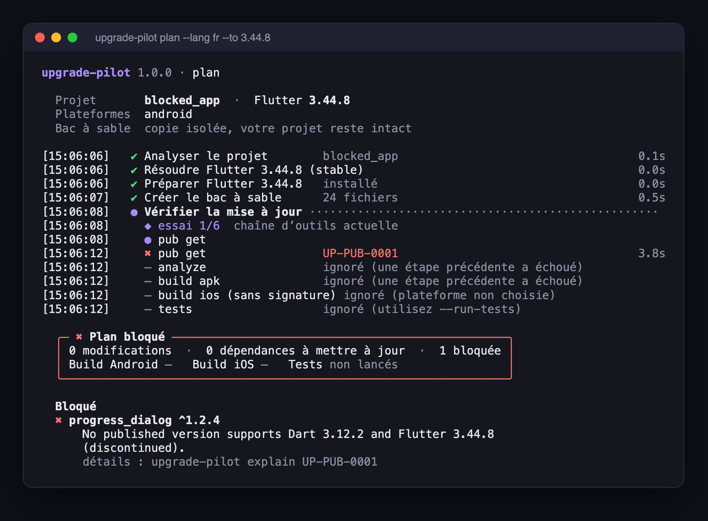

# upgrade-pilot

Simule une mise à jour Flutter sur une copie de votre projet, corrige ce qui casse, et vous donne un plan **prouvé par un vrai build**.



*Exécution réelle : la dépendance `progress_dialog` n'a aucune version compatible Dart 3, l'outil le prouve avec le log de `pub get` et sort avec le code 2.*

## Pourquoi

Une mise à jour de Flutter change en même temps Gradle, le plugin Android (AGP), Kotlin, le JDK requis, les contraintes `pub` et la cible iOS. Les outils existants donnent des conseils ou modifient vos fichiers, et on découvre ensuite si ça compile.

upgrade-pilot fait l'inverse : il essaie la mise à jour dans un bac à sable, relance le build jusqu'à ce qu'il passe, et ne vous propose que des changements qui ont réellement compilé. Votre projet n'est jamais touché avant `apply`.

## Installation

```sh
dart pub global activate --source git https://github.com/Andassa/upgrade-pilot
upgrade-pilot doctor
```

`doctor` vérifie Flutter, le JDK, le SDK Android, Xcode, git, le réseau et l'espace disque.

## Utilisation

```sh
upgrade-pilot plan --to stable     # simule la mise à jour (rien n'est modifié)
upgrade-pilot report --open        # rapport HTML : diff exact + preuves
upgrade-pilot apply                # applique le plan vérifié, avec sauvegarde
upgrade-pilot apply --revert       # annule
```

| Commande | Rôle |
|---|---|
| `plan` | `--to 3.44.9 / 3.44 / stable / latest`, `--platforms android,ios`, `--run-tests`, `--offline`, `--timeout 20m` |
| `report` | `--format html / md / json` (le Markdown se colle dans une PR) |
| `explain UP-AND-0007` | cause, extrait du log, correctif et source d'un problème |
| `kb update` | met à jour la base de compatibilité (somme SHA-256 vérifiée) |
| `clean` | vide les caches et bacs à sable restants |

Options globales : `--json`, `--ci`, `--no-color`, `--ascii`, `--lang fr`.
Codes de sortie : `0` vérifié, `1` mauvaise commande, `2` bloqué, `3` environnement incomplet, `4` interrompu (Ctrl+C), `70` erreur interne.

## Comment ça marche

1. **Analyse** du projet : `pubspec`, lockfile, Gradle (Groovy ou Kotlin DSL), AGP, Kotlin, Podfile, FVM.
2. **SDK cible** : réutilise votre Flutter, FVM ou le cache s'il est déjà à la bonne version ; sinon télécharge l'archive officielle et vérifie sa somme SHA-256. Votre Flutter global et votre `PATH` ne sont jamais modifiés.
3. **Bac à sable** : copie privée du projet (dossier `0700`), sans keystores, `key.properties`, `.env` ni certificats.
4. **Boucle de vérification** : applique une combinaison d'outils, lance `pub get → analyze → build apk → build ios → tests`. En cas d'échec, une règle de diagnostic identifie la cause et propose la correction suivante ; si aucune ne s'applique, l'outil essaie une autre combinaison. La recherche est bornée (6 essais, 20 min par défaut).
5. **Plan** : le diff exact (y compris les migrations faites par Flutter lui-même), les commandes exécutées avec leurs durées, et une section **« Non vérifié »** toujours présente.

## Diagnostic et base de compatibilité

- [`data/rules.json`](data/rules.json) : 31 règles « motif du log → cause → correctif », chacune avec sa source officielle (AGP trop ancien, Gradle incompatible avec le JDK, migration Kotlin d'AGP 9, dépendance sans null safety, plugin sans namespace, cible iOS, disque plein…). Si aucune règle ne correspond, l'outil affiche « cause non identifiée » avec l'extrait du log, sans inventer.
- [`data/kb.json`](data/kb.json) : seuils et versions des outils de Flutter 3.22 à 3.47, tirés du code de `flutter_tools` et des docs Android et Gradle, avec la date de relevé. Une valeur inconnue reste `unknown`.

## Sécurité

- Les secrets ne sont jamais copiés ni lus ; les logs et rapports sont expurgés (jetons, mots de passe, chemins personnels).
- Les commandes sont lancées sans shell, avec un environnement filtré (vos jetons n'y passent pas).
- Le réseau se limite à pub.dev et aux archives officielles de Flutter. Aucune télémétrie.
- `apply` vérifie que vos fichiers n'ont pas changé depuis `plan`, exige un dépôt git propre (sauf `--force`) et garde une sauvegarde.

L'outil exécute le build de votre projet (scripts Gradle, plugins) : utilisez-le sur des projets de confiance, comme `flutter build`.

## Par rapport aux outils existants

Testés sur le même projet ancien (AGP 8.1, Gradle 8.3, Kotlin 1.8) avec Flutter 3.44 et JDK 25 :

| Outil | Résultat après ses corrections |
|---|---|
| `flutter_compat` | build cassé : il écrit `gradle-8.14.0`, une version qui n'existe pas |
| `flutterfix` | build cassé : Gradle 8.11 ne tourne pas sur JDK 25 |
| `flutter_build_doctor` | build cassé : même erreur JDK, AGP et Kotlin non détectés |
| `flutter_app_update_guard` | bon score de risque par dépendance, mais ne compile pas |
| **upgrade-pilot** | le plan *est* le résultat du build |

## Limites

- Un build qui passe ne prouve pas que l'app se comporte pareil : lancez vos tests (`--run-tests`) et l'app.
- Le build iOS demande macOS et Xcode ; ailleurs il est marqué « non vérifié ».
- Le build Android est en debug : les problèmes propres à la release (R8, signature) ne sont pas couverts.
- Les modifications de code exigées par Flutter sont signalées, pas réécrites.
- Télécharger un SDK demande environ 4 Go ; un build Android peut aussi télécharger le NDK (~3 Go).

<a id="troubleshooting"></a>

## Dépannage

- **Disque plein** (`UP-ENV-0001`) : `upgrade-pilot clean`, puis libérez de l'espace.
- **NDK incomplet** (`UP-ENV-0005`) : supprimez le dossier indiqué, Flutter le retélécharge.
- **Gradle incompatible avec votre JDK** (`UP-AND-0001`) : le plan monte Gradle ; pour changer de JDK : `flutter config --jdk-dir=<chemin>`.
- **Hors ligne** : `--offline` utilise le cache ; sortie `3` si rien n'a jamais été mis en cache.

## Contribuer

```sh
make verify        # format, analyse, tests, couverture, scan de secrets
make integration   # vraies exécutions sur test/fixtures (Flutter + SDK Android)
```

Pour ajouter une règle : ajoutez-la dans `data/rules.json` avec sa source, mettez un extrait de log réel dans `test/unit/diagnose/samples.dart`, puis lancez `make data && make verify`.

Licence [Apache-2.0](LICENSE).
