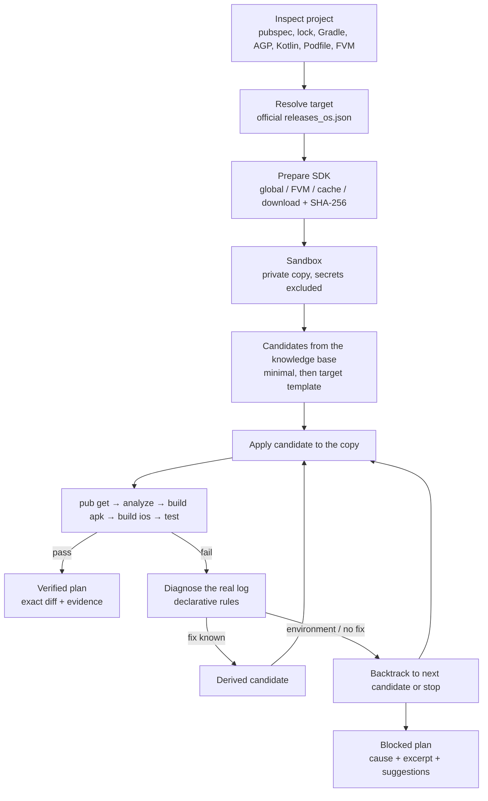
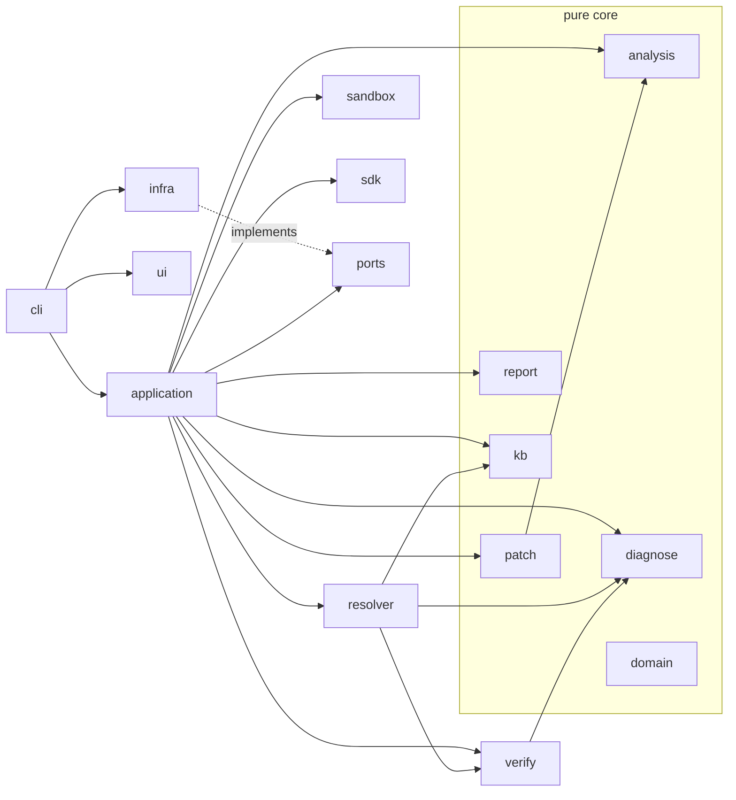

# upgrade-pilot

**Rehearse your next Flutter upgrade in a sandbox. Apply only what is proven.**

Upgrading Flutter breaks builds in ways that are hard to predict: the Android Gradle Plugin, Gradle, Kotlin, the JDK, `pub` constraints and iOS deployment targets all move at once. Existing tools give advice or edit your files directly, and you discover whether it builds afterwards. `upgrade-pilot` copies your project into an isolated sandbox, runs the target Flutter SDK on it, repairs what breaks, and gives you a **verified plan**: the exact diff, plus the build logs that prove it.

```
upgrade-pilot plan --to stable      # simulate (your project is not touched)
upgrade-pilot report --open         # share the evidence
upgrade-pilot apply                 # apply the verified diff, with a backup
```

> Français : `upgrade-pilot` simule une mise à jour Flutter sur une copie isolée de votre projet, corrige ce qui casse (Gradle, AGP, Kotlin, dépendances…), puis produit un plan vérifié par un vrai build. Rien n'est modifié avant `apply`. L'interface est disponible en français : `--lang fr` ou `UPGRADE_PILOT_LANG=fr`.

---

## Contents

- [Install](#install)
- [What a run looks like](#what-a-run-looks-like)
- [Commands](#commands)
- [How `plan` works](#how-plan-works)
- [Diagnostics](#diagnostics)
- [Knowledge base](#knowledge-base)
- [Reports](#reports)
- [Compared to existing tools](#compared-to-existing-tools)
- [Architecture](#architecture)
- [Security and threat model](#security-and-threat-model)
- [Design decisions](#design-decisions)
- [Limits](#limits)
- [Troubleshooting](#troubleshooting)
- [Contributing](#contributing)
- [Development](#development)

## Install

Requires the Dart SDK (shipped with Flutter).

```sh
dart pub global activate --source git https://github.com/Andassa/upgrade-pilot
upgrade-pilot doctor
```

Native binaries for macOS (arm64, x64), Linux and Windows are attached to each [GitHub release](https://github.com/Andassa/upgrade-pilot/releases), with SHA-256 checksums and a CycloneDX SBOM. Shell completion: `upgrade-pilot completion zsh|bash|fish`.

## What a run looks like

The excerpts below are copied from real executions on macOS (Flutter 3.44.8, JDK 25) with `NO_COLOR` and a non-interactive terminal; only the timestamps printed in this mode were removed. `doc/demo.sh` reproduces them.

**`doctor`** checks what verification needs:

```
upgrade-pilot 1.0.0 · doctor

  ✔ Flutter          3.44.8 (current project SDK)
  ✔ git              2.54.0 (Apple Git-157)
  ✔ JDK              25.0.3 (Android Studio)
  ✔ Android SDK      ~/Library/Android/sdk
  ✔ Xcode            Xcode 27.0
  ✔ CocoaPods        1.16.2
  ✔ Network          pub.dev reachable
  ✔ Disk             5.8 GB free in cache
  ✔ Knowledge base   2026.10.24 · 10 Flutter releases · sha256 2c42f450c20c

  ✔ Ready to plan.
```

**A blocked dependency** (`test/fixtures/blocked_dependency`, which depends on `progress_dialog`): pub.dev is queried, no version supports Dart 3, the real log is shown, and the exit code is 2.

```
  ✔ Inspect project           blocked_app                                   0.0s
  ✔ Resolve Flutter 3.44.8 (stable)                                         0.0s
  ✔ Prepare Flutter 3.44.8    installed                                     0.0s
  ✔ Create sandbox            24 files                                      1.0s
  ● Verify upgrade ····························································
    ◆ attempt 1/6  current toolchain
    ● pub get
    ✖ pub get                 UP-PUB-0001                                   3.7s
    ─ analyze                 skipped (an earlier step failed)
    ─ build apk               skipped (an earlier step failed)
    ─ build ios (no-codesign) skipped (platform not selected)
    ─ tests                   skipped (use --run-tests)

  ╭─ ✖ Plan blocked ─────────────────────────────────────╮
  │ 0 changes  ·  0 dependencies to update  ·  1 blocked │
  │ Android build ─   iOS build ─   Tests not run        │
  ╰──────────────────────────────────────────────────────╯

  Blocked
  ✖ progress_dialog ^1.2.4
      No published version supports Dart 3.12.2 and Flutter 3.44.8
      (discontinued).
      details: upgrade-pilot explain UP-PUB-0001

  Diagnosis
  ✖ UP-PUB-0001  Dependency without null safety  (pub get)
      Cause: progress_dialog >=1.0.0 predates null safety and cannot be used
      with Dart 3.
      Fix: Upgrade progress_dialog to a version compatible with the target Dart
      SDK.
      │ The current Dart SDK version is 3.12.2.
      │ 
      │ Because blocked_app depends on progress_dialog >=1.0.0 which doesn't
      │ support null safety, version solving failed.
      │ 
      │ The lower bound of "sdk: '>=2.0.0-dev.68.0 <3.0.0'" must be 2.12.0 or
      │ higher to enable null safety.
      │ For details, see https://dart.dev/null-safety
      │ Failed to update packages.
      https://dart.dev/null-safety
```

**A Flutter 3.24-era project** (`test/fixtures/legacy_toolchain`: AGP 8.1.0, Gradle 8.3, Kotlin 1.8.22, `http: ^0.12.2`), verbatim from an early `--ci` run in an ASCII terminal. The knowledge base moved AGP, Gradle and Kotlin to versions that run on JDK 25; `pub get` failed, rule `UP-PUB-0002` read pub's own suggestion, and the next attempt resolved with `http ^1.6.0`:

```
[12:26:28]     i attempt 1/6  AGP 8.1.0 → 8.11.1, Gradle 8.3 → 9.1.0, Kotlin 1.8.22 → 2....
[12:26:28]     * pub get
[12:26:33]     x pub get             UP-PUB-0002                                       5.2s
[12:26:33]     ~ retry 2/6  AGP 8.1.0 → 8.11.1, Gradle 8.3 → 9.1.0, Kotlin 1.8.22 → 2.2....
[12:26:33]     * pub get
[12:26:44]     ok pub get                                                              11.1s
```

On that machine the Android build then stopped on an NDK left incomplete by an earlier interrupted download, which led to rule `UP-ENV-0005` (an environment problem: the search stops instead of trying other toolchains). The complete Android and iOS runs of the three fixtures are executed by the `integration` job of [CI](https://github.com/Andassa/upgrade-pilot/actions) on clean Ubuntu and macOS runners.

In an interactive terminal, progress is a single spinner line, there is one accent color, and every status has a symbol (never color alone). The block-letter wordmark only appears on the welcome screen (`upgrade-pilot` without argument).

## Commands

```
upgrade-pilot doctor                      check Flutter, Dart, JDK, Android SDK, Xcode, git, network, disk
upgrade-pilot plan [--to <version|stable|beta|latest|3.44>] [--path <dir>]
                   [--platforms android,ios] [--run-tests] [--jobs N]
                   [--keep-sandbox] [--timeout 20m] [--offline] [--max-attempts 6]
upgrade-pilot report [--format html|md|json] [--open] [-o file]
upgrade-pilot apply [--yes] [--force] [--revert]
upgrade-pilot explain <finding-id>        cause, evidence, fix and source of a problem
upgrade-pilot kb update                   install a newer knowledge base (SHA-256 verified)
upgrade-pilot clean [--keep-sdks]         caches, plans, leftover sandboxes (backups are kept)
upgrade-pilot completion <bash|zsh|fish>
```

Global options: `--json` (stable, versioned output), `--no-color`, `--ascii`, `--quiet`, `--verbose` (diffs, stack traces), `--ci` (no animation, timestamped stable lines), `--lang en|fr`.
`NO_COLOR`, `FORCE_COLOR`, `CI`, `TERM=dumb` and non-TTY outputs are respected.

| Exit code | Meaning |
|---|---|
| 0 | plan verified (with or without warnings), or command succeeded |
| 1 | invalid usage |
| 2 | plan has unresolved blocking problems |
| 3 | incomplete environment (Flutter missing, disk full, offline without cache…) |
| 4 | interrupted (Ctrl+C) |
| 70 | internal error |

## How `plan` works



1. **Inspect**: reads `pubspec.yaml`, `pubspec.lock`, `.metadata`, `.fvmrc`, Gradle wrapper, `settings.gradle(.kts)`, `build.gradle(.kts)`, version catalogs, `gradle.properties`, `Podfile`, `project.pbxproj`. Groovy and Kotlin DSL are both supported.
2. **Target SDK**: `--to` accepts a version, a minor (`3.44` = latest patch), `stable`, `beta` or `latest`. The SDK is taken, in this order, from the global Flutter (read-only, only if it is exactly the target), FVM, the upgrade-pilot cache, or downloaded from the official archive with its published SHA-256 verified. Your global Flutter, your `PATH` and your Flutter settings are never modified.
3. **Sandbox**: a `0700` temporary directory with an unpredictable name. Files are copied with copy-on-write clones when the file system allows it (`cp -c` on APFS, `--reflink` on Linux). `build/`, `.dart_tool/`, `.git/`, `Pods/`, keystores, `key.properties`, `.env*`, certificates and provisioning profiles are never copied nor read; symbolic links are never followed. Monorepos (`resolution: workspace`) and `path:` dependencies are copied from their common root.
4. **Verification loop**: bounded depth-first search with backtracking (attempts, depth and time budgets). Initial candidates come from the knowledge base (the minimal toolchain Flutter accepts without warnings, then the toolchain of the target Flutter template); failures produce derived candidates through the diagnostic rules. Dependency fixes learned on one branch apply to every later candidate.
5. **Plan**: the final diff is computed by comparing the sandbox with your project, so it also contains the migrations Flutter itself performs during the build (for example `android.builtInKotlin=false` added by Flutter 3.44+). Every step records the command, duration, exit code and a redacted excerpt.
6. **Cleanup**: the sandbox is deleted on success, failure and Ctrl+C (a second Ctrl+C forces it).

## Diagnostics

Rules live in [`data/rules.json`](data/rules.json): a regex `pattern` with named captures, a `cause`, a `fix`, a structured `action`, a `confidence`, a `docsUrl`, and the `source` and `patternFrom` of the message. When nothing matches, the report says **"cause not identified"** and shows the relevant log lines: no cause is invented.

| Id | Problem | Automatic action |
|---|---|---|
| UP-PUB-0001/2/3/4/6 | null safety, pub suggestion, Dart or Flutter SDK constraint, project SDK constraint | newest compatible version from pub.dev, pub's suggested constraint, widen `environment.sdk` |
| UP-PUB-0005 | conflicting constraints | none (explained) |
| UP-AND-0001 | Gradle cannot run on this JDK (e.g. the bare `25.0.3` error) | Gradle ≥ minimum for the JDK |
| UP-AND-0002/3/4/5 | AGP, Gradle, Kotlin, Java below Flutter's minimum | bump to Flutter's thresholds |
| UP-AND-0006 | AGP needs a newer Gradle | bump Gradle |
| UP-AND-0007/8 | AGP 9 built-in Kotlin, new DSL | `android.builtInKotlin=false`, `android.newDsl=false` |
| UP-AND-0009/10 | Kotlin metadata, Gradle too old for KGP | bump Kotlin / Gradle |
| UP-AND-0011/12/15 | minSdk, compileSdk, compileSdk vs AGP | set levels, bump AGP |
| UP-AND-0014/16/19 | plugin without namespace, v1 embedding, Kotlin error in a plugin | upgrade the plugin |
| UP-AND-0017/18/20 | jlink on Java 21, non-existent Gradle distribution, JVM target mismatch | bump AGP, fix the distribution name, align JVM 17 |
| UP-DART-0001/2 | compile error in a dependency / in your code | upgrade the dependency / manual migration |
| UP-IOS-0001/2/3 | deployment target, CocoaPods specs, Xcode | raise iOS target / explain |
| UP-ENV-0001…0005 | disk full, network, Android SDK, memory, broken NDK | stop and explain |

`upgrade-pilot explain UP-AND-0007` prints the rule, its source and, if the last plan hit it, the real excerpt.

## Knowledge base

[`data/kb.json`](data/kb.json) stores, per Flutter minor release (3.22 → 3.47): the toolchain of the Flutter template, Flutter's own error/warning thresholds for Gradle, AGP, Kotlin and Java, SDK levels and the iOS template target; plus the official tables AGP → minimum Gradle, JDK → Gradle range and compileSdk → minimum AGP. Every entry cites its source (`flutter_tools/lib/src/android/gradle_utils.dart`, `DependencyVersionChecker.kt` and templates at the release tag, developer.android.com, docs.gradle.org) and a `retrievedAt` date. Values the sources do not state are `unknown` and are never guessed: the build decides.

The KB is embedded in the binary with its SHA-256. `upgrade-pilot kb update` downloads the published copy and its `.sha256`, verifies both, and only installs a newer version. A weekly workflow checks that every cited URL still answers and that the current Flutter stable is covered.

## Reports

- **Terminal**: the summary shown at the end of `plan`.
- **Markdown** (`report -f md`): ready for a pull request comment, diffs in collapsible blocks.
- **JSON** (`--json`, `report -f json`): `reportSchemaVersion` 1, stable keys, diffs only (no file contents).
- **HTML** (`report --open`): one self-contained file, inline CSS, light and dark themes, no script, no external resource, a Content-Security-Policy of `default-src 'none'`, keyboard navigation and semantic tables.

Every report has a **Not verified** section (skipped platforms, tests not run, and always: *a successful build does not prove that the app behaves the same*). Secrets, tokens and personal paths are redacted (`~`).

## Compared to existing tools

Tested on the same project with an old toolchain (AGP 8.1.0, Gradle 8.3, Kotlin 1.8.22) under Flutter 3.44.8 and JDK 25, then built with `flutter build apk --debug`.

| | Scope | What it did on the test project | Build after its changes |
|---|---|---|---|
| [flutter_app_update_guard](https://pub.dev/packages/flutter_app_update_guard) 1.1.0 | dependency risk scoring; `simulate <pkg>` runs pub get + analyze in a sandbox, per dependency | good risk report; `simulate http` passed in 7.5 s | not its goal (no build, no SDK switch) |
| [flutter_compat](https://pub.dev/packages/flutter_compat) 0.1.3 | environment and compatibility doctor, `fix --dry-run` for Gradle/AGP/Kotlin | correct detection of the three outdated versions; `fix -y` wrote `gradle-8.14.0-all.zip` | failed: that distribution does not exist (HTTP 404; Gradle names it `8.14`) |
| [flutterfix](https://pub.dev/packages/flutterfix) 1.3.0 | one-command fixer | moved Gradle to 8.11, left AGP 8.1.0 and Kotlin 1.8.22, reported "fixed successfully" | failed: Gradle 8.11 cannot run on JDK 25 |
| [flutter_build_doctor](https://pub.dev/packages/flutter_build_doctor) 0.1.0 | build doctor and fixer | moved Gradle to 8.14; did not detect AGP/Kotlin in `settings.gradle.kts` | failed: same JDK 25 error |
| **upgrade-pilot** | target-version simulation in a sandbox, bounded repair search, verified plan, apply/revert | candidates computed from Flutter's own thresholds and the JDK; changes kept only if the build passes | the plan is the build result |

These tools are useful and often faster for what they target (risk scoring, quick doctoring). `upgrade-pilot` does not re-implement dependency risk scoring; it focuses on **proving** an upgrade to a given Flutter version, and on saying plainly what was not proven.

## Architecture

Hexagonal: dependencies point to the domain; only `infra` touches processes, network and disk. An architecture test enforces it.



| Layer | Role |
|---|---|
| `domain` | pure models: snapshot, release, candidate, change (hunks), finding, evidence, plan, redaction |
| `ports` | interfaces: file system, processes, HTTP, host, console, clock, progress |
| `analysis` | parsers: pubspec/lock, Gradle (Groovy/KTS/TOML), Podfile, pbxproj, FVM, `.metadata` |
| `kb` | knowledge base model, embedded data, integrity check |
| `diagnose` | declarative rules engine |
| `patch` | conservative editors (yaml_edit, targeted regex), unified diff, zero-context hunks |
| `sandbox` | copy policy, private copy, reset, diff |
| `sdk` | release catalog, SDK manager, JDK locator |
| `verify` | Flutter commands, allow-listed environment |
| `resolver` | pub.dev client, strategy, bounded backtracking |
| `report` | Markdown, JSON, HTML |
| `ui` | terminal capabilities, style, components, live progress, i18n (en, fr) |
| `application` | use cases: plan, apply/revert, doctor, explain, kb update, clean |
| `infra` | `dart:io` implementations |
| `cli` | commands, error format, exit codes, completion |

## Security and threat model

`upgrade-pilot` **runs the build of the project you point it at**: Gradle scripts, CocoaPods, build runners and plugins execute with your user rights. Only use it on projects you trust, exactly as you would with `flutter build`.

| STRIDE | Threat | Mitigation |
|---|---|---|
| Spoofing | tampered SDK archive or KB | official URLs only, TLS verified, SHA-256 of archives (from `releases_*.json`) and of the KB checked before use |
| Tampering | plan edited or project changed between `plan` and `apply` | `apply` checks a project fingerprint and the SHA-256 of every file, refuses dirty git trees (unless `--force`), writes atomically, keeps a reversible backup |
| Repudiation | "it said build OK" | every verdict comes with the command, exit code, duration and log excerpt |
| Information disclosure | secrets in logs, reports, caches | keystores, `key.properties`, `.env*`, certificates never copied nor read; child processes get an allow-listed environment (tokens dropped); excerpts and diffs redacted; plans store hashes and changed lines only, never full files. A dedicated test plants fake secrets and searches every output, cache and child environment |
| Denial of service | runaway builds, full disk | time budget, per-step timeouts, attempt and depth limits, free-space check before downloads, `UP-ENV-0001` |
| Elevation of privilege | shell injection, path traversal, symlink escape | processes started with argument lists only (no shell), paths validated against the sandbox root, links never followed, `0700` sandbox with unpredictable names |

Network access is limited to `pub.dev/api/packages/`, `storage.googleapis.com/flutter_infra_release/` and this repository's raw `data/` files. There is **no telemetry**; Flutter and Dart analytics are disabled for child processes.

Supply chain: few dependencies, versioned `pubspec.lock`, OSV scan and gitleaks in CI, CycloneDX SBOM and checksums attached to releases.

**Reporting a vulnerability**: open a [private security advisory](https://github.com/Andassa/upgrade-pilot/security/advisories/new). Please do not file public issues for vulnerabilities.

## Design decisions

1. **Dart.** Same ecosystem as the users, `pub global activate`, single native binary per platform with `dart compile exe`, first-class YAML and semver libraries.
2. **Positioning.** No dependency risk scoring (well covered by `flutter_app_update_guard`); the value is a target-version simulation proven by a real build, see [Compared to existing tools](#compared-to-existing-tools).
3. **Proof over prediction.** The knowledge base only chooses where to start; a change is kept only if the build passes. Unknown KB values stay unknown.
4. **Diff from the sandbox.** The plan is the difference between the project and the sandbox after a successful build, so migrations done by the Flutter tool are included and nothing is described that was not executed.
5. **Bounded depth-first search with backtracking.** Builds take minutes: a few well-chosen candidates and rule-driven fixes beat a combinatorial search. Limits: 6 attempts, depth 4, 20 minutes (configurable).
6. **Declarative rules with sources.** Rules are data with tests, so contributions do not require touching the engine; every rule cites where its message and fix come from.
7. **Hashes and hunks, not file contents.** Plans and backups contain checksums and changed lines only, so secrets in untouched lines never reach the cache; `apply` refuses any file that changed.
8. **Reuse installed SDKs read-only.** The global or FVM SDK is used when it is exactly the target; otherwise the official archive goes to an isolated cache. The user's environment is never modified.
9. **Hexagonal architecture with injectable ports.** Everything except `infra` is tested without Flutter, network or disk; an architecture test keeps it that way.
10. **Dependencies.** `args` (CLI), `pub_semver` (versions), `yaml` and `yaml_edit` (read and edit pubspec without losing comments), `path`, `http` (allow-listed client), `crypto` (SHA-256), `meta`. `package:process` was not added: the needed port is smaller than its API.
11. **Terminal design.** One accent color, symbols for every status, ASCII fallback, width 40–120, no animation outside interactive TTYs, a fixed error format (title / why / what to do / more info), golden tests for every mode.
12. **English by default, complete French.** One string catalog; French uses "vous"; a test checks that both languages have the same keys and placeholders. Diagnostic rule texts are in English.
13. **Embedded data.** The KB and rules are compiled into the binary with their SHA-256, so the tool works offline and cannot be altered by a writable data file.

## Limits

- A passing build is not a passing app: behaviour, performance and plugins' runtime changes are not verified. Use `--run-tests` and run your app.
- iOS builds need macOS with Xcode; they are reported as **not verified** elsewhere.
- The Android build is a debug APK (`--debug`); release-only problems (R8, signing) are not covered.
- Transitive dependency problems are explained but not fixed automatically (the direct dependency that requires them must be upgraded by hand).
- The KB covers Flutter 3.22 to 3.47; older or newer versions rely on the build and the rules only.
- Downloading a Flutter SDK needs about 4 GB of free space; Android builds may also download an NDK (~3 GB).
- Code changes required by Flutter breaking changes (`UP-DART-0002`) are diagnosed, not rewritten.

## Troubleshooting

- **Disk full** (`UP-ENV-0001`, exit 3): `upgrade-pilot clean` removes SDK downloads, caches and leftover sandboxes; Gradle and pub caches are yours to prune.
- **Broken NDK** (`UP-ENV-0005`): delete the folder named in the message; Flutter downloads it again.
- **Gradle cannot run on your JDK** (`UP-AND-0001`): the plan bumps Gradle; to use another JDK, run `flutter config --jdk-dir=<path>`.
- **Offline**: `--offline` uses the cached release list, SDKs and pub.dev metadata; it fails with exit 3 when something was never cached.
- **CI**: add `--ci --json`; the exit code tells whether the upgrade is verified (0) or blocked (2).

## Contributing

Adding a diagnostic rule:

1. Reproduce the failure and copy the relevant lines of the real log.
2. Add the rule to `data/rules.json` (order is priority) with `id` `UP-<AREA>-<NNNN>`, `patterns` (named captures such as `package`, `min`), `cause` and `fix` templates, an `action` from the list in `lib/src/diagnose/rules.dart`, `confidence`, `docsUrl`, the official `source`, `patternFrom` and `retrievedAt`.
3. Add the log excerpt to `test/unit/diagnose/samples.dart`; the tests check that every rule has a sample and matches it first.
4. Run `make data` then `make verify`.

KB updates follow the same path: edit `data/kb.json` with sources, `make data`, `make verify`. Commits follow Conventional Commits.

## Development

```sh
make help            # every target
make verify          # format, data checksums, analyzer (fatal infos), tests, coverage gates, secret scan
make test            # unit + golden + security + architecture tests, coverage per layer
make golden          # rewrite terminal goldens after an intended UI change
make integration     # real runs on test/fixtures (Flutter + Android SDK needed)
make demo            # doc/demo.sh: a reproducible real run into build/demo
make build           # native binary in build/
make release-dry-run
```

Coverage gates: 85 % for `domain`, `analysis`, `kb`, `diagnose`, `patch`, `report`, `ui`; 70 % elsewhere. Current: 95 % overall.

## License

[Apache-2.0](LICENSE).
